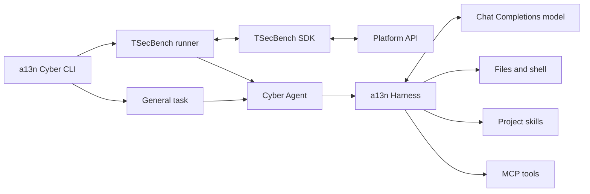

# 🔯 a13n Cyber

[](https://www.python.org/)
[](https://docs.astral.sh/uv/)

**A general-purpose autonomous security agent built on a13n Harness.**

a13n Cyber investigates and executes security tasks using workspace tools, procedural skills, MCP capabilities, and configurable models. Build task-specific agents on a shared Harness runtime and extend their behavior through native capabilities.



- **Run a task.** Give the agent a prompt and a workspace with file and command tools.
- **Evaluate on TSecBench.** Fetch challenges, start targets, submit flags, and release environments automatically.
- **Compose capabilities.** Load SDK-native agent instructions and MCP configuration, and discover project skills.

## Work from source

You need **Python 3.13 or later** and **[uv](https://docs.astral.sh/uv/getting-started/installation/)**.

```bash
git clone https://github.com/saurlax/a13n-cyber.git
cd a13n-cyber
uv sync --locked
```

Configure the three required model environment variables before running commands. `doctor` validates them offline and reports credential presence without printing the key; missing configuration fails before any network request.

## Run an agent

Copy `.env.example` to `.env` and explicitly set `LLM_BASE_URL`, `LLM_MODEL`, and `LLM_API_KEY` for your Chat Completions provider. No provider, model, or credential defaults are supplied. Then run a task:

```bash
uv run --locked --env-file .env a13n-cyber run "Inspect the files and summarize the application architecture" --workspace ./work
```

The workspace is created if absent. Shell execution uses PowerShell on Windows and Bash or sh on Unix, with the current process's authority. Direct Local execution is not an OS sandbox.

Bound execution explicitly when needed:

```bash
uv run --locked --env-file .env a13n-cyber run "Analyze the application" --workspace ./work --request-limit 50 --token-limit 100000 --timeout 600
```

Both modes default to 100 model requests, 200,000 total tokens, and a 3,600-second execution deadline. Benchmark challenges share the invocation's request and token allowances. Token accounting follows provider-reported usage; limits are not a currency budget.

## Run TSecBench

For local evaluation, obtain a task's `BENCHMARK_BASE_URL` and `BENCHMARK_TOKEN` from the platform and connect its VPN before starting:

```bash
uv run --locked --env-file .env a13n-cyber tsecbench --workspace ./work --max-challenges 2 --challenge-timeout 900
```

The runner uses the official SDK to check VPN connectivity and process incomplete challenges sequentially. Each challenge gets a separate working directory and a fresh Harness Run. The agent receives challenge-scoped `submit_flag` and `get_progress` tools. `--allow-hints` additionally exposes `get_hint`; requesting hints can reduce scores.

The runner closes a target after completion, failure, timeout, or cancellation. It refreshes platform progress instead of treating the agent's final text as proof of success. Local execution ends after the selected challenge pass, all challenges complete, or a stop condition occurs. Exiting the container does not assert that the platform has finalized the evaluation.

Standard output contains the final JSON result. Standard error contains application lifecycle events and safe error categories. An incomplete challenge pass can finish normally; use `completed_challenges` and `stop_reason` to interpret the result.

## Customize the agent

Load SDK-native AgentSpec YAML or JSON with `--agent-spec`:

```bash
uv run --locked --env-file .env a13n-cyber run "Review the evidence" --workspace ./work --agent-spec agents/analyst.yaml
```

The same option works with `tsecbench`. AgentSpec supplies instructions, model settings, and supported capabilities, including native MCP declarations. Model selection remains in environment configuration; deadlines and usage limits remain application-owned. Harness UI resource files such as `mcp_servers` catalogs are a different format.

Place skills under the selected workspace:

```text
work/.agents/skills/
  investigation/
    SKILL.md
    references/
```

Each `SKILL.md` has YAML frontmatter with `name` and `description`. General Runs discover skills under `/workspace/.agents/skills`. Benchmark Runs read the same project's skills through a file-only project mount while writing to separate challenge directories. Skills supply instructions; install their required CLI binaries and MCP servers separately in the execution environment.

See the [Harness MCP guide](https://a13n.dev/docs/a13n-harness/mcp/) for native declarations compatible with the installed SDK.

## Configure models and credentials

Supply `LLM_BASE_URL`, `LLM_MODEL`, and `LLM_API_KEY` explicitly in the process environment. All three are required; unset, empty, or whitespace-only values are rejected. There are no vendor-specific credential aliases. uv and Docker can load an untracked `.env` file.

| Variable | Default | Purpose |
| --- | --- | --- |
| `LLM_BASE_URL` | Required | Chat Completions API base URL |
| `LLM_MODEL` | Required | Provider model identifier |
| `LLM_API_KEY` | Required | Model API credential |
| `LLM_REASONING_EFFORT` | Unset | Optional `low`, `medium`, or `high`, when supported by the provider |
| `LLM_REQUEST_TIMEOUT` | `60` | Provider and platform request timeout in seconds |
| `LLM_MAX_OUTPUT_TOKENS` | `512` | Output limit for the connectivity check only |
| `BENCHMARK_BASE_URL` | Unset | Required platform endpoint for TSecBench mode |
| `BENCHMARK_TOKEN` | Unset | Required evaluation task credential |

The core uses your configured Chat Completions endpoint. Enable reasoning effort only when supported by that endpoint. For hosted TSecBench evaluation, supply the permitted gateway, model identifier, and API key on its submission page; the platform supplies benchmark credentials separately.

To make one bounded connectivity request:

```bash
uv run --locked --env-file .env a13n-cyber llm-smoke
```

The check consumes model quota. It does not retry automatically or print model content. Unit tests use explicit test configuration. `doctor` requires the three model variables but never contacts the provider.

## Build a container

Docker builds install production dependencies with `uv sync --locked --no-dev --no-editable`. The image contains no model configuration and displays CLI help by default. Select a task or integration command explicitly.

```bash
docker build --platform linux/amd64 -t a13n-cyber:dev .
docker run --rm --network none --env-file .env a13n-cyber:dev doctor
docker run --rm a13n-cyber:dev --help
```

Run a general task with explicit model configuration:

```bash
docker run --rm --env-file .env a13n-cyber:dev run "Inspect the workspace" --workspace /app/work
```

For the optional benchmark integration, select its command explicitly:

```bash
docker run --rm --env-file .env a13n-cyber:dev tsecbench
```

On Windows, the build script also runs the offline diagnostic with explicit test-only configuration:

```powershell
./scripts/build-image.ps1
./scripts/build-image.ps1 -Export
```

`-Export` writes `dist/a13n-cyber.tar` and prints its SHA256 digest. Override the base image with `-PythonBaseImage` or Docker's `PYTHON_BASE_IMAGE` build argument. Local benchmark containers still need connectivity to the platform's target network.

## Development

| Task | Command |
| --- | --- |
| Install the locked environment | `uv sync --locked` |
| Run offline diagnostics | `uv run --locked --env-file .env a13n-cyber doctor` |
| Run tests | `uv run --locked python -m unittest discover -s tests -v` |
| Lint Python | `uv run --locked ruff check .` |
| Check formatting | `uv run --locked ruff format --check .` |
| Update the dependency lock | `uv lock` |

Read the [specification catalog](spec/README.md) before changing public behavior or architecture. [AGENTS.md](AGENTS.md) defines repository conventions. Application code lives in `src/tsec_agent/`, tests in `tests/`, and container tooling in `scripts/`.

## Resources

- [a13n Harness documentation](https://a13n.dev/docs/a13n-harness/)
- [Agent Foundation](https://github.com/converge-ai-labs/agent-foundation)
- [TSecBench integration guides](https://tsecbench.zc.tencent.com/#integration)
