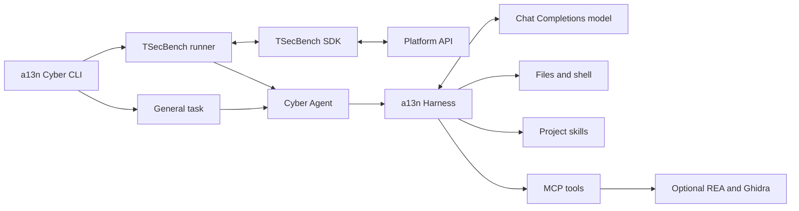

# 🔯 a13n Cyber

[](https://www.python.org/)
[](https://docs.astral.sh/uv/)

**A general-purpose autonomous security agent built on a13n Harness.**

a13n Cyber investigates and executes security tasks using workspace tools, procedural skills, MCP capabilities, and configurable models. Build task-specific agents on a shared Harness runtime and extend their behavior through native capabilities.



- **Run a task.** Give the agent a prompt and a workspace with file and command tools.
- **Evaluate on TSecBench.** Fetch challenges, start targets, submit flags, and release environments automatically.
- **Compose capabilities.** Load SDK-native agent instructions and MCP configuration, and discover project skills.

## Work from source

You need **Python 3.13 or later** and **[uv](https://docs.astral.sh/uv/getting-started/installation/)**.

```bash
git clone https://github.com/saurlax/a13n-cyber.git
cd a13n-cyber
uv sync --locked
```

Configure the three required model environment variables before running commands. `doctor` validates them offline and reports credential presence without printing the key; missing configuration fails before any network request.

## Run an agent

Copy `.env.example` to `.env` and explicitly set `LLM_BASE_URL`, `LLM_MODEL`, and `LLM_API_KEY` for your Chat Completions provider. No provider, model, or credential defaults are supplied. Then run a task:

```bash
uv run --locked --env-file .env a13n-cyber run "Inspect the files and summarize the application architecture" --workspace ./work
```

The workspace is created if absent. Shell execution uses PowerShell on Windows and Bash or sh on Unix, with the current process's authority. Direct Local execution is not an OS sandbox.

Bound execution explicitly when needed:

```bash
uv run --locked --env-file .env a13n-cyber run "Analyze the application" --workspace ./work --request-limit 50 --token-limit 100000 --timeout 600
```

Both modes default to 10,000 model requests, 100,000,000 total tokens, and a 21,600-second (6-hour) execution deadline. Benchmark challenges share the invocation's request and token allowances. Token accounting follows provider-reported usage; limits are not a currency budget.

## Run TSecBench

For local evaluation, obtain a task's `BENCHMARK_BASE_URL` and `BENCHMARK_TOKEN` from the platform and connect its VPN before starting:

```bash
uv run --locked --env-file .env a13n-cyber tsecbench --workspace ./work
```

The runner uses the official SDK to check VPN connectivity and process every incomplete challenge sequentially, without a challenge-count limit. Each challenge gets a separate working directory and a fresh Harness Run. The agent receives challenge-scoped `submit_flag` and `get_progress` tools. `--allow-hints` additionally exposes `get_hint`; requesting hints can reduce scores.

The default per-challenge deadline is 3,600 seconds (1 hour). Request and token allowances are shared across the entire evaluation. The runner attempts every incomplete challenge unless the platform ends the task, an execution limit is reached, execution is cancelled, or a fatal error occurs. Platform deadlines remain authoritative even when local limits allow a longer run.

Agent responses have no application-imposed output token cap unless `max_tokens` is explicitly configured in AgentSpec model settings. For providers that stream cumulative usage, set `openai_continuous_usage_stats: true` in those settings to avoid counting the same usage repeatedly.

The runner closes a target after completion, failure, timeout, or cancellation. It refreshes platform progress instead of treating the agent's final text as proof of success. Local execution ends after a pass over all incomplete challenges, all challenges complete, or an explicit stop condition occurs. Exiting the container does not assert that the platform has finalized the evaluation.

Standard output contains the final JSON result. Standard error contains application lifecycle events and safe error categories. An incomplete challenge pass can finish normally; use `completed_challenges` and `stop_reason` to interpret the result.

To watch detailed agent execution and retain it locally, enable the native event stream:

```bash
uv run --locked --env-file .env a13n-cyber tsecbench --agent-spec agents/analyst.yaml --verbose --log-dir ./runs/evaluation
```

`--verbose` displays readable model output, labeled tool calls and results, and run summaries on stderr; `--log-dir` independently appends structured UTF-8 records to `agent.jsonl` and updates content-free `progress.json`. Events include model text and thinking fragments, tool calls and results, usage, and failure codes. Configured credentials and submission arguments are redacted; input prompts, binary media, provider signatures, and raw error bodies are omitted. Detailed logs can contain task content. Keep the directory outside version control. Logs do not provide restart or conversation recovery.

On Windows, follow the detailed event file without interrupting the agent:

```powershell
uv run --locked a13n-cyber logs ./runs/evaluation --follow
```

The log viewer joins model fragments, preserves multiline tool output, and hides internal event plumbing. It requires no model credentials, makes no network requests, and can follow an already-running evaluation without restarting it. Press Ctrl+C to stop viewing; the agent continues running.

The same observation options work with `run`. Execution commands reserve standard output for the final JSON result; `logs` writes readable output to standard output.


## Customize the agent

Load SDK-native AgentSpec YAML or JSON with `--agent-spec`:

```bash
uv run --locked --env-file .env a13n-cyber run "Review the evidence" --workspace ./work --agent-spec agents/analyst.yaml
```

The same option works with `tsecbench`. AgentSpec supplies instructions, model settings, and supported capabilities, including native MCP declarations. Model selection remains in environment configuration; deadlines and usage limits remain application-owned. Harness UI resource files such as `mcp_servers` catalogs are a different format.

Place skills under the selected workspace:

```text
work/.agents/skills/
  investigation/
    SKILL.md
    references/
```

Each `SKILL.md` has YAML frontmatter with `name` and `description`. All Runs discover the packaged skills under `/environment/builtin/skills` through a file-only mount with a read-only permission ceiling. General Runs additionally discover skills under `/workspace/.agents/skills`. Benchmark Runs read the same project's skills through a file-only project mount while writing to separate challenge directories. Skill names must be unique across packaged and project sources. Skills supply instructions; install their required CLI binaries and MCP servers separately in the execution environment.

See the [Harness MCP guide](https://a13n.dev/docs/a13n-harness/mcp/) for native declarations compatible with the installed SDK.

## Configure models and credentials

Supply `LLM_BASE_URL`, `LLM_MODEL`, and `LLM_API_KEY` explicitly in the process environment. All three are required; unset, empty, or whitespace-only values are rejected. There are no vendor-specific credential aliases. uv and Docker can load an untracked `.env` file.

| Variable | Default | Purpose |
| --- | --- | --- |
| `LLM_BASE_URL` | Required | Chat Completions API base URL |
| `LLM_MODEL` | Required | Provider model identifier |
| `LLM_API_KEY` | Required | Model API credential |
| `LLM_REASONING_EFFORT` | Unset | Optional `low`, `medium`, or `high`, when supported by the provider |
| `LLM_REQUEST_TIMEOUT` | `60` | Positive provider and platform request timeout in seconds; no application upper bound |
| `LLM_MAX_OUTPUT_TOKENS` | `512` | Positive output limit for the connectivity check only; subject to provider limits |
| `BENCHMARK_BASE_URL` | Unset | Required platform endpoint for TSecBench mode |
| `BENCHMARK_TOKEN` | Unset | Required evaluation task credential |
| `A13N_REA_ROOT` | Unset | Installed `rea-agents` package directory; enables REA tools and its bundled skill |

The core uses your configured Chat Completions endpoint. Enable reasoning effort only when supported by that endpoint. For hosted TSecBench evaluation, supply the permitted gateway, model identifier, and API key on its submission page; the platform supplies benchmark credentials separately.

To make one bounded connectivity request:

```bash
uv run --locked --env-file .env a13n-cyber llm-smoke
```

The check consumes model quota. It does not retry automatically or print model content. Unit tests use explicit test configuration. `doctor` requires the three model variables but never contacts the provider.

## Build a container

Docker builds install production dependencies and the basic toolkit with `uv sync --locked --no-dev --no-editable --extra toolkit`. The image contains no model configuration and displays CLI help by default. Select a task or integration command explicitly.

```bash
docker build --platform linux/amd64 -t a13n-cyber:dev .
docker run --rm --network none --env-file .env a13n-cyber:dev doctor
docker run --rm a13n-cyber:dev --help
```

Run a general task with explicit model configuration:

```bash
docker run --rm --env-file .env a13n-cyber:dev run "Inspect the workspace" --workspace /app/work
```

For the optional benchmark integration, select its command explicitly:

```bash
docker run --rm --env-file .env a13n-cyber:dev tsecbench
```

The Python build script also runs the offline diagnostic with explicit test-only configuration:

```bash
uv run --locked python scripts/build-image.py
uv run --locked python scripts/build-image.py --export
```

`--export` writes `dist/a13n-cyber.tar` and prints its SHA256 digest. Override the base image with `--python-base-image` or Docker's `PYTHON_BASE_IMAGE` build argument. Local benchmark containers still need connectivity to the platform's target network.

## Basic toolkit

The container includes tools the agent can use directly through its shell capability:

| Capability | Included tools |
| --- | --- |
| Files and data | Bash, curl, jq, Git, ripgrep, file, tar, unzip, zip, xxd |
| Network inspection | OpenSSL, netcat, Nmap, ffuf |
| Binary analysis | GNU binutils, GDB, GCC, Make, pwntools 4.15.0 |
| Python execution | Python 3.13+, uv, the application virtual environment |

Three packaged skills, `a13n-toolkit`, `a13n-http-inspection`, and `a13n-binary-inspection`, describe tool selection and bounded inspection workflows. Their files ship inside the Python package, so mounting an empty or separate workspace does not hide them. The toolkit skill points to an inventory at `/environment/builtin/toolkit.json`; descriptions are discovered before skill bodies are read. No separate AgentSpec is needed to activate these skills.

The inventory describes the container, not arbitrary source-installation hosts. To install the Python portion locally:

```bash
uv sync --locked --extra toolkit
```

Install the OS CLI tools separately on the host. In the container, `python` on PATH selects the same virtual environment that contains pwntools. Packaged tools do not require additional MCP servers. Browser binaries, large wordlists, and template-scanning engines are not included in this basic toolchain. Container permissions still determine whether raw-packet scans and debugger operations are available.

The image records OS package versions in `/usr/local/share/a13n-cyber/system-packages.tsv`; Python versions are locked in `uv.lock`. Debian packages follow the signed repositories used at build time. To verify a built image without credentials or network access:

```bash
docker run --rm --network none --entrypoint python a13n-cyber:dev /app/scripts/check-image.py
```

The check exercises CLI availability, pwntools packing and ELF inspection, assembly of a harmless instruction, skill discovery and reading through Harness, denial of built-in file mutation, and shell access to the installed Python environment with an offline model. The build script runs this check before exporting an image.

## REA image

The optional [REA](https://github.com/morluto/rea) image extends the basic toolkit with REA 6.7.0, Node.js 24.15.0, a full JDK 21, procps, and Ghidra 12.1.4. npm dependencies are locked in `integrations/rea/package-lock.json`; the Ghidra release archive is verified against its pinned SHA256 before extraction. This variant is larger and Ghidra analysis needs additional memory.

```bash
uv run --locked python scripts/build-image.py --rea --image a13n-cyber:rea
docker run --rm --env-file .env a13n-cyber:rea run "Inspect the authorized binary in the workspace" --workspace /app/work
docker run --rm --env-file .env a13n-cyber:rea tsecbench
```

The image enables the integration automatically through `A13N_REA_ROOT`; no additional AgentSpec is required. The agent discovers the complete version-matched `reverse-engineer-anything` skill and loads the `rea` MCP capability when needed. Each Run owns its local MCP connection and subprocess. Ghidra is selected explicitly for native analysis; browser, Android, and other external engines are not installed by this image.

For a source installation, install the pinned npm dependencies and point `A13N_REA_ROOT` at the package directory:

```bash
npm ci --prefix integrations/rea --omit=dev --ignore-scripts --no-audit --no-fund
```

Set `A13N_REA_ROOT` to the absolute path of `integrations/rea/node_modules/rea-agents`. Node.js must be on PATH. Native decompilation additionally requires a compatible Ghidra installation, a full JDK, and `GHIDRA_INSTALL_DIR`/`JAVA_HOME`; set `REA_ANALYSIS_PROVIDER=ghidra` to select it. REA's setup command and global agent registrations are unnecessary. An unset `A13N_REA_ROOT` keeps the integration disabled.

REA runs local analysis tools with the container user's permissions. The read-only skill mount protects packaged instructions from Harness file mutations; it does not sandbox MCP tools. Only the execution environment and selected provider settings are passed to the REA subprocess. Model and benchmark credentials are excluded.

The build script runs both toolkit verification and the following REA check without networking before `--export` can save the image:

```bash
docker run --rm --network none --entrypoint python a13n-cyber:rea /app/scripts/check-rea.py
```

This check connects to the installed MCP server, verifies its catalog and package identity, compiles a synthetic C fixture, and asks Ghidra to decompile its function. It makes no model requests and never contacts benchmark targets. REA and Ghidra retain their upstream license and notice files in the image; see [REA's third-party notices](https://github.com/morluto/rea/blob/main/THIRD_PARTY_NOTICES.md).

## Development

| Task | Command |
| --- | --- |
| Install the locked environment | `uv sync --locked` |
| Run offline diagnostics | `uv run --locked --env-file .env a13n-cyber doctor` |
| Run tests | `uv run --locked python -m unittest discover -s tests -v` |
| Lint Python | `uv run --locked ruff check .` |
| Check formatting | `uv run --locked ruff format --check .` |
| Update the dependency lock | `uv lock` |

Read the [specification catalog](spec/README.md) before changing public behavior or architecture. [AGENTS.md](AGENTS.md) defines repository conventions. Application code lives in `src/tsec_agent/`, tests in `tests/`, and container tooling in `scripts/`.

## Resources

- [a13n Harness documentation](https://a13n.dev/docs/a13n-harness/)
- [Agent Foundation](https://github.com/converge-ai-labs/agent-foundation)
- [TSecBench integration guides](https://tsecbench.zc.tencent.com/#integration)
