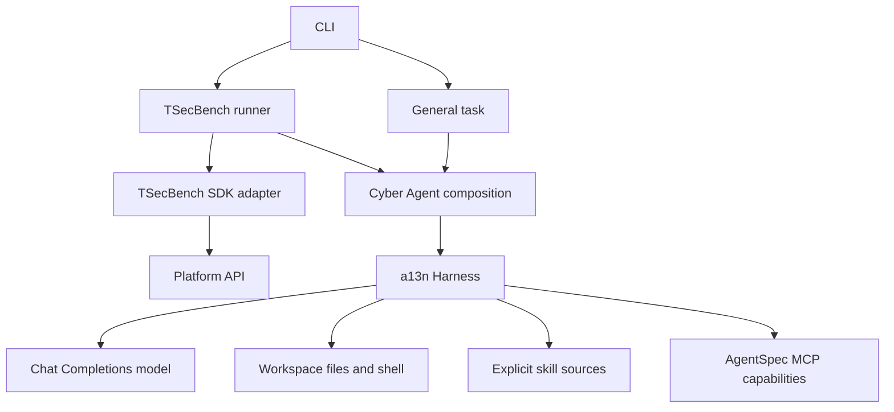

# Architecture

a13n Cyber embeds a13n Harness in one Python process. The same agent composition serves user tasks and TSecBench challenges. The application does not implement a second model/tool loop.

The CLI parses inputs, validates configuration, maps exit status, and prints JSON results. Agent composition owns model construction, stable instructions, capabilities, and per-run Harness bindings. The TSecBench adapter owns SDK calls and platform-error classification. The runner owns selection, deadlines, authoritative progress, workspace isolation, and cleanup. Platform tools are bound to one challenge and never accept a model-selected task token or challenge identifier.

Credentials remain in application-owned clients. Tool results and logs omit credentials. Live clients and bindings are not continuation state. General workspace execution uses Direct Local with the current process's authority; it is not an OS sandbox. Container isolation is a deployment boundary.

Durable scheduling, process-restart continuation, async subagent hosting, and platform task-finalization APIs are outside this execution contract.

The repository uses uv with a committed lockfile. Production images exclude development dependencies. Ruff configuration lives in `pyproject.toml`; local and CI validation use that same configuration. In-process MCP server dependencies belong to the development group for offline integration tests.
